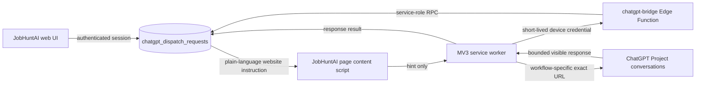

# ChatGPT Plus website bridge

ChatGPT communication uses the Chrome Manifest V3 Website Bridge. It does not call `api.openai.com`, use the retired user-created ChatGPT app, read ChatGPT cookies, intercept network traffic, or reuse the employer-form helper credential. Legacy OAuth/MCP database migrations are retained as historical schema; their browser routes are removed and their stored OAuth access tokens are revoked by migration `0108_bridge_bulk_job_url_imports.sql`.

## Boundary and data flow



The page bridge never receives subject references or applicant content. A page action posts only a versioned hint containing `request_id`, `correlation_id`, and a nonce. The extension claims the request through the bridge function, delivers the server-provided plain-language task exactly once, and captures only the next completed assistant response in the bound conversation. The response is bounded and returned to the webapp; it is not a history export, cookie read, or network interception. There is no plugin or MCP fallback path.

The browser-form helper at `supabase/functions/form-agent-bridge` remains a separate boundary. Its sessions, device tokens, permissions, and tables are not used by this bridge.

## Dispatch protocol

The wire schema is versioned independently of the UI adapter:

| Field | Meaning |
| --- | --- |
| `schema_version` | Server protocol version, currently `1.0.0`. |
| `action_type` / `action_version` | Allowlisted action and its contract version. |
| `origin` | `user_click`, `explicit_automation`, or `diagnostic`. |
| `subject_refs` | Small, shape-validated owned UUID references. Never raw applicant content. |
| `idempotency_key` | Unique per user; repeated requests return the original dispatch. |
| `state` | Server-owned delivery/workflow state. |
| `website_instruction` | Plain-language task sent by the Website Bridge. It contains no internal dispatch protocol instructions. |
| `manual_instruction` | Compatibility alias for `website_instruction` used by older extension versions. |
| `bridge_response` | Bounded assistant response captured from the target conversation. |
| `correlation_id` | Safe cross-system audit correlation identifier. |

Supported actions are `job.inspect_url`, `jobs.search.manual`, `jobs.analyse_selected`, `documents.cv.create`, `documents.cover_letter.create`, `emails.process_now`, `tracker.sync_now`, and `bridge.diagnostic`. Each action has a maximum batch size, allowed effects, confirmation policy, expected outputs, timeout, and retry policy. The action handler supplies the plain-language `website_instruction`, which the bridge delivers without adding JobHuntAI, request IDs, or other internal protocol language. The database policy is authoritative at runtime.

Delivery states are:

```text
queued -> claimed_by_extension -> opening_chatgpt -> composer_ready -> send_attempted -> sent
                                                                  |
                                             acknowledged_by_mcp -> running -> completed

Any pre-send delivery state may become user_required, failed, expired, or cancelled.
```

`sent` means the extension’s semantic adapter verified the exact outgoing instruction. The bridge then waits for one completed assistant response and records it as `completed`. If that response cannot be captured, the request becomes `user_required`; the user may inspect the chat or use the Website Bridge's safe pre-send retry when the server proves the Send boundary was not crossed. `acknowledged_by_mcp` is retained as a historical/compatibility state name; no MCP app or fallback is active.

### Durable delivery v2

Extension `0.2.3` uses the v2 delivery RPCs from migration `0083_chatgpt_bridge_delivery_v2.sql`, with retry and response-check hardening in `0084_chatgpt_bridge_safety_hardening.sql`, boundary reconciliation in `0085_chatgpt_bridge_boundary_reconciliation.sql`, adaptive backoff in `0086_chatgpt_adaptive_concurrency_backoff.sql`, protocol compatibility in `0087_chatgpt_bridge_protocol_v2_compatibility.sql`, capability upgrades in `0088_chatgpt_bridge_capability_upgrade.sql`, and rollout telemetry in `0089_chatgpt_bridge_rollout_telemetry.sql`. A claim receives a unique `delivery_attempt_id`, a two-minute pre-send deadline, and a bounded response deadline. The service limits a device to two active requests and prevents two claims for the same workflow conversation. Navigation, composer mutation, and Send remain serialized because they touch one ChatGPT UI surface; read-only response capture can run concurrently in the two bound workflow chats.

The content scripts carry a build identity as well as the semantic extension version. Each script installs a replaceable controller with an instance id, removes its runtime listeners and timers when replaced, and probes the existing controller before reusing it. The background worker accepts a tab as ready only when its ping reports the current build identity and conversation URL; an older or unresponsive listener is reloaded before delivery. This prevents an extension reload or SPA reinjection from leaving a stale listener beside the current one.

The one-time boundary is explicit: one database transaction authorizes Send and stores the rendered conversation turn anchor, the extension persists that state locally, and only then does the content adapter click the visible Send control. On restart, the extension reconciles the server state before doing any UI work. A lost runtime message or worker restart can inspect the exact outgoing turn and confirm it, but it never types or clicks again after the server fence has been consumed. After a verified send, the response lease is capped by the request deadline; lease heartbeats cannot extend it indefinitely. A visible pre-send rate limit is deferred using a parsed relative retry duration when available, otherwise five minutes, clamped to 30 seconds through 30 minutes; the device runs at one generation until that persisted backoff expires and then restores the two-generation limit. A manually started generation causes a 15-second defer without reducing capacity, and the fifth bounded busy claim becomes `user_required`. A rate limit after Send is treated as an attempted delivery, stops the request for manual review, and is never resent automatically. The popup reports the reduced-capacity window and active generation phases.

Captured responses are written to a local extension outbox before the completion RPC. The optional `professional-profile.json` download happens only after the server accepts the response and has a durable at-most-once receipt, so a failed completion cannot download and overwrite the same file repeatedly. Upload retries use a persisted exponential backoff and stop after bounded attempts or a permanent deployment/data error; a stopped response remains locally available for manual recovery and never causes a second ChatGPT generation. A blocked outbox item is reconciled with read-only server status on extension startup, popup refresh, and queue polls before any ChatGPT UI/setup gate: if the exact request and delivery-attempt identity are valid and the server confirms `completed`, the extension clears only the stale local warning; if completion is not confirmed or the identity is incomplete, the captured result remains available for manual recovery. This reconciliation never sends or uploads the ChatGPT message. The web UI uses one shared status poller per dispatch id with exponential retry for transient HTTP failures and wakes immediately on bridge acceptance/rejection events. The existing v1 RPCs remain available during rollout so older installed tabs can finish their leases, but an ambiguous legacy delivery is never eligible for automatic retry because it has no durable v2 send marker.

The exact pre-send turn anchor is also recorded in the v2 request before the visible Send click and remains authoritative after any post-send identity refinement. An explicit completed-response check links back to that original request (or reuses its own marker during activation recovery) and copies the anchor into the read-only ticket. If an older request has no durable anchor, the bridge stops the check safely instead of guessing which duplicate prompt a response belongs to. Every v2 poll also reconciles expired delivery and response deadlines, including requests whose overall expiry has already passed, so a sent request cannot remain stranded in `sent` indefinitely.

The V3 saved-response check is strictly read-only. If Chrome drops the `CHECK_DISPATCH_RESPONSE` runtime channel after readiness was proved, the extension discards that tab's readiness proof, revalidates its bound conversation and inactive-tab focus, re-establishes the versioned content reader, and retries only that read command. It is capped at three reader attempts with a 350 ms retry delay; a failed readiness/focus check stops immediately with `response_check_unavailable`. This path never calls `START_DISPATCH`, writes to the composer, or clicks Send, and the original ChatGPT user message is never resent. The assistant/artifact turn fence is still checked by the content adapter and the database capture guard on every recovered result.

### Exact-turn response provenance

Structured profile capture also waits for the bound conversation history to settle before taking its baseline. The response reader then requires the exact newly-sent user turn, waits for the enabled Stop control to disappear, and records content-free assistant/artifact provenance. A visible older `professional-profile.json` artifact is never accepted merely because it is the latest JSON on screen. Migration `0097_chatgpt_response_provenance.sql` stores and validates this proof at v3 completion, and the onboarding importer refuses completed rows without the marker. Migration `0098_chatgpt_bridge_onboarding_reset_reconciliation.sql` lets an authenticated onboarding reset cancel every indexed Memory dispatch, including sent/result-pending rows, without editing ChatGPT history. The extension receives explicit server result-completion capabilities and refuses to claim v2 work until the matching free-tier Edge Function and migrations are live.

Before a Memory or activation request is created, the webapp now checks the paired device's live heartbeat, Automatic Send state, verified `profile.background` conversation, background-focus policy, extension version/build, and both v3 result/provenance capabilities. A missing or stale status fails closed with no queued request. Migration `0099_chatgpt_bridge_dispatch_readiness.sql` advertises the server contract through the existing audited status RPC, while `0100_chatgpt_bridge_quarantine_pre_v3_dispatches.sql` cancels only pre-Send requests tied to devices that cannot satisfy that contract; the audit record explicitly states that no ChatGPT message was sent. The extension popup exposes the last heartbeat and any startup/transport error, and build ids include a content hash so an unpacked reload cannot silently reuse an older bundle under the same commit.

### Lifecycle diagnostics

Migrations `0090_chatgpt_bridge_lifecycle_diagnostics.sql`,
`0091_chatgpt_bridge_lifecycle_post_send.sql`, and
`0092_chatgpt_bridge_lifecycle_async_writes.sql`, and
`0093_chatgpt_bridge_lifecycle_first_observation.sql` store a separate,
allow-listed lifecycle object on each dispatch. It records the browser hint,
extension receipt, server claim, bound-tab and content-script readiness,
composer readiness, the one-time Send boundary, verified user turn, response
detection, and response upload. The object also carries a bounded recovery
phase. It is deliberately separate from `progress_json`, because delivery
state transitions replace progress at safety fences; it contains no task text,
ChatGPT response, pairing code, device token, lease token, or conversation
content. Repeated hints keep the first timestamp for each stage, so retries
cannot make the sequence appear to run backwards. Lifecycle writes are
serialized per request in the extension and are
detached from the UI operation, so a slow diagnostics request cannot add a
bridge cooldown or delay the one-time Send path.

The diagnostics status route projects only that safe object. It also reports the
preferred server device, paired extension version, build id, and online state.
The JobHunt page asks the local content script for a non-secret status snapshot,
so diagnostics distinguishes a missing extension, an unpaired browser, a
different local device, an outdated build, and a heartbeat/offline condition
from a slow ChatGPT generation. It also distinguishes a captured response
waiting for upload from a transport failure. A retry button is rendered only when the server's authoritative
`retry_allowed` flag confirms that neither `send_attempted_at` nor `sent_at`
exists; once the Send boundary is crossed the page cannot offer a resend.
Lifecycle timestamps are validated and kept monotonic by the database RPC.

## Pairing and binding

1. In JobHuntAI Settings, create a one-time pairing code. It expires after ten minutes and is stored hashed.
2. Install the locally built extension and enter the Supabase Edge Function URL, code, and a display name.
3. The Edge Function generates a random device token, stores only its hash, and returns the raw token once to the extension. The token is stored in `chrome.storage.local`; it is never put in a page message or log.
4. Ensure ChatGPT is signed in and can create Projects. The extension does not open ChatGPT's `+`/app picker or try to select an app during dispatch. It will reuse an exact `JobHuntAI` Project or create it through ChatGPT's visible Projects UI during setup.
5. Choose **Set up JobHuntAI + workflow chats**. The extension first reuses the server-recorded Project conversation bindings from an earlier bridge pairing, then creates one fixed-marker chat only for each genuinely missing workflow through the visible Project UI. The pause between newly created chats is user-configurable in seconds and defaults to 15 seconds. Progress is saved so a safe stop can be resumed without duplicate setup messages.
6. Enable **Automatic Send** only after setup. Enabling it is a separate server-side opt-in and is rejected unless at least one workflow slot is verified.
7. If a conversation becomes too long, select that workflow and choose **Create fresh selected chat**. The extension creates and binds the replacement automatically, disables Automatic Send, and changes only that slot; **Bind/rebind selected chat** remains the manual fallback.

When a newer extension version is paired with a fresh one-time code, the server copies the previous device's verified workflow slots to the new device and transfers still-queued requests. An active previous device's Automatic Send setting is carried over; a revoked previous device restores its chats with Automatic Send off. Existing ChatGPT Projects and chats should therefore be left in place during an extension upgrade. Chats that were never bound to a JobHuntAI bridge device cannot be identified safely by title alone and still require manual binding.

The extension stores one canonical conversation URL per workflow slot. The default slots are `Job inspection`, `Job search`, `Job analysis`, `CV drafting`, `Cover-letter drafting`, `Email processing`, `Tracker sync`, and `Bridge diagnostic`. It does not search conversations, switch accounts, or use a broad content-script selector to choose a conversation. Manual binding remains available for users who prefer to create chats themselves.

Rebinding a slot replaces only its URL, clears its usage timestamps, disables Automatic Send, and leaves the queued/running/completed JobHuntAI dispatch record untouched. A long ChatGPT conversation therefore does not need to be continued: the user can rotate that workflow to a fresh chat while the Website Bridge remains the system of record.

## Visible UI adapter and safe failure

The adapter uses semantic accessibility attributes and visible controls rather than brittle coordinates. It verifies the current URL, Project label, sign-in state, blocking dialogs, composer uniqueness, exact text after insertion, and one enabled Send control. Project setup additionally requires exactly one visible Projects navigation control, existing exact Project entry, or New/Create Project control; it never renames a different Project. It stops for user action when any of these checks is ambiguous, including:

- login, CAPTCHA, MFA, permission, confirmation, or “allow access” dialog;
- wrong account, wrong Project, wrong conversation, or changed URL;
- missing/ambiguous composer or Send control;
- an already-generating response;
- a changed locale or ChatGPT DOM that no longer exposes a safe semantic control;
- a missing or ambiguous assistant response after the one-time delivery message;
- a response that cannot be returned to the webapp before the bounded lease expires.

After a delivery response is lost, the extension records `delivery_uncertain` and never resends automatically. The popup’s explicit retry action first asks the bridge to requeue a verified pre-send request; it renews an expired request for one bounded action timeout, but it cannot requeue a request whose server record crossed the Send boundary. Legacy ambiguous deliveries require manual conversation review.

## Safe result recovery

The extension stores a captured assistant response in its local outbox before attempting completion. If upload fails, it retries that same captured response under the bridge's bounded backoff and v3 response-provenance contract; it does not resend the original ChatGPT message. The UI exposes a retry only when the authoritative server record confirms that no Send attempt occurred. After an ambiguous or completed Send, recovery remains tied to that exact assistant turn and never offers a new send as an upload retry.

Document actions create `needs_review` versions only. CV triggers continue to reject unsupported claims and material bullets without verified evidence. No bridge action approves documents, submits an application, sends an email, or changes a Human Gate.

## Memory and previous knowledge

ChatGPT Memory is controlled by the user in ChatGPT Settings → Personalization. JobHuntAI does not inspect ChatGPT’s private memory and does not try to toggle it. The `candidate_chatgpt_memory` record stores only the user’s confirmation and preference to use previous knowledge; it is not a memory export. The Settings panel displays this distinction.

## Permissions and threat model

The generated manifest requests only `storage`, `tabs`, `alarms`, `scripting`, and `downloads` (the last permission is used only for the bounded professional-profile JSON artifact). Host access is the exact configured JobHuntAI origin plus `https://chatgpt.com/*` and `https://chat.openai.com/*`. It requests no `<all_urls>`, cookies, webRequest, debugger, history, or clipboard permission.

Threat mitigations include:

- pairing codes are one-time, short-lived, and hashed;
- device tokens are random, hashed server-side, revocable, and separate from the employer helper;
- dispatch leases are short-lived, bounded, target-device aware, and attempt limited;
- tables have RLS enabled with explicit deny policies; client table grants are absent;
- service-role functions are callable only by the Edge Function;
- each Website Bridge dispatch is authenticated, owner-scoped, target-device aware, and idempotent;
- subject references are allowlisted, size-limited, and ownership-checked;
- external job pages are treated as untrusted research content by the Website Bridge task;
- only the next bounded assistant response is stored for the user-scoped dispatch; the extension also keeps a short-lived local delivery record and response outbox so a worker restart can retry the same completion; no conversation history, cookies, or credentials are collected;
- audit events record action type, correlation id, subject key names, device, and safe error codes, not prompt bodies or credentials.

## Local development

From the repository root:

```bash
JOB_HUNT_ORIGIN=http://localhost:3000 npm run chatgpt-bridge:build
npm --workspace @jobhunt/chatgpt-bridge-extension run typecheck
npm --workspace @jobhunt/chatgpt-bridge-extension run test
npm run chatgpt-bridge:verify
```

The unpacked extension is `apps/chatgpt-bridge-extension/dist`. Load that directory through Chrome → Extensions → Developer mode → Load unpacked. The distributable zip is generated alongside it. A build with no environment overrides targets the production JobHuntAI origin and bridge endpoint below; set `JOB_HUNT_ORIGIN` and `JOB_HUNT_BRIDGE_ENDPOINT` explicitly for local or alternate environments.

For the deployed JobHuntAI Console, build the production-targeted bundle with the exact application origin and bridge endpoint. The endpoint is injected into the popup and granted as the extension's narrowly scoped bridge host permission:

```bash
JOB_HUNT_ORIGIN=https://job-hunt-console.yashwanth-sooriya.workers.dev \
JOB_HUNT_BRIDGE_ENDPOINT=https://sgarcjiqkvlhldmrlsqo.supabase.co/functions/v1/chatgpt-bridge \
npm run chatgpt-bridge:build
```

The Edge Function is `supabase/functions/chatgpt-bridge`. Its only secret is the Supabase service-role key supplied by the Supabase runtime. The extension never receives that key.

## Reproducible release evidence

The extension version is declared once, in
`apps/chatgpt-bridge-extension/package.json`. The build injects that value
into the browser bundles, options page, and generated Manifest V3 file. It
also gives every browser bundle one build id derived from the source commit;
`JOB_HUNT_BUILD_ID` may be supplied when reproducing a recorded artifact.
The ZIP entry order and timestamps are fixed, so the same source commit and
build id produce the same SHA-256.

Migration `0081_chatgpt_bridge_delivery_timing.sql` is the canonical 0081
entry. The previously proposed rate-limit repair was intentionally renumbered
to `0082_chatgpt_rate_limit_dispatcher_grant_repair.sql`; the old duplicate
0081 filename must not be restored. The release verifier checks this mapping
and rejects duplicate numeric migration prefixes.

Release evidence is recorded in
`docs/releases/chatgpt-bridge-v<version>.json`. It names the clean source
commit that produced the artifact, extension version, build id, ZIP SHA-256, Cloudflare
deployment, Supabase Edge Function version, and applied migration head. To
rebuild and check the exact recorded ZIP:

```bash
JOB_HUNT_BUILD_ID=<build-id-from-release-evidence> npm run chatgpt-bridge:build
npm run chatgpt-bridge:release-verify -- --artifact
```

The ordinary bridge gate remains useful for a clean checkout as it rebuilds
the current commit, runs extension and web tests/type-checks, and checks the
static migration and rollout invariants:

```bash
npm ci
npm run chatgpt-bridge:verify
```

For a production release, apply the migration and deploy the function with an authenticated Supabase CLI session (the exact project ref is intentionally not committed):

```bash
npx supabase link --project-ref "$SUPABASE_PROJECT_REF"
npx supabase db push
npx supabase functions deploy chatgpt-bridge --no-verify-jwt
```

The Cloudflare Worker deployment requires the public Supabase configuration and existing Google OAuth runtime secrets; Google Picker configuration is not required. The Supabase service-role key stays inside the Supabase Edge Function and is not required or uploaded to the Cloudflare web Worker. The bridge migration/function must be live before enabling the Settings panel for users. These safeguards use the existing Cloudflare/Supabase tiers; do not increase limits or add paid services to address bridge retries.

## Operations

### Rollout telemetry and v1 retirement

After the v2 acceptance runbook has completed, run the repository verifier against a paired v2 device. The verifier authenticates with that device's short-lived bridge credential and calls the read-only `get_rollout_telemetry` operation. The response contains only counts, timestamps, bounded request/device ids, states, error-free timing values, response hashes/length metadata, and capability versions; it never contains a website instruction or captured response.

```bash
CHATGPT_BRIDGE_ENDPOINT=https://sgarcjiqkvlhldmrlsqo.supabase.co/functions/v1/chatgpt-bridge \
CHATGPT_BRIDGE_DEVICE_ID=<paired-device-id> \
CHATGPT_BRIDGE_DEVICE_TOKEN=<paired-device-token> \
node scripts/verify-chatgpt-bridge-rollout.mjs --live --require-v2-completions
```

The rollout is healthy only when `expired_active_leases`, `overrenewed_leases`, `orphaned_send_attempted`, `lost_result_uploads`, `completed_v2_missing_upload_metadata`, and `unsafe_bridge_events_in_window` are all zero. A non-zero `pending_result_uploads` is expected only while a response remains inside its bounded response deadline; investigate it if the count remains after the next poll or appears in `lost_result_uploads`. The verifier also reports active paired v1 devices. Keep the v1 RPCs and fallback path enabled while that count is non-zero; retire v1 only after every non-revoked paired device advertises the complete v2 capability set and the clean telemetry result has remained stable through the observation window. Revoke stale devices explicitly before treating them as upgraded.

Run the static gate in CI or before a deployment even when live credentials are unavailable:

```bash
npm run chatgpt-bridge:verify-rollout
```

The telemetry query and audit guard are service-role-only. They are not exposed through the Supabase Data API, and the audit guard rejects bridge event metadata containing instruction or response-text keys.

- Revoke a device in JobHuntAI Settings to disable Automatic Send, invalidate future calls, stop pre-delivery requests, and remove every server-recorded workflow conversation binding. The page sends a device-scoped local reset: only a browser holding that exact device credential clears its local state, so revoking an older device cannot unpair a newly paired browser. The external ChatGPT Project and its conversations are intentionally not deleted; pairing and automatic setup must be run again.
- If a conversation is renamed, moved, or deleted, bind a new dedicated conversation. Binding and rotation preserve the Automatic Send setting; disable it first only when you want to pause delivery.
- If ChatGPT changes its semantic controls, update `src/content/ui-adapter.ts`, add a fixture, add a regression test, and rebuild the zip. Do not broaden selectors to “make it work.”
- To remove local credentials, revoke the device server-side and remove the extension from Chrome. To remove server records, use the existing account/data deletion workflow after revocation; the bridge tables cascade from the user.
- There is no claim of Chrome Web Store publication in this repository. Store listing, review, signing, and live human acceptance remain release tasks requiring the account owner.
