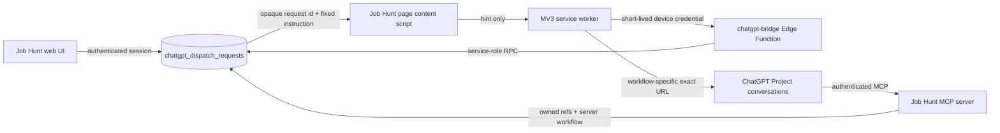

# ChatGPT Plus website bridge

Milestone 28 adds a Chrome Manifest V3 bridge for users who have ChatGPT Plus but no OpenAI API key. It uses the visible ChatGPT website and the authenticated Job Hunt MCP app. It does not call `api.openai.com`, read ChatGPT cookies, intercept network traffic, scrape ChatGPT answers, or reuse the employer-form helper credential.

## Boundary and data flow



The page bridge never receives subject references or applicant content. A page action posts only a versioned hint containing `request_id`, `correlation_id`, and a nonce. The extension claims the opaque ID through the bridge function. Only the MCP server, after validating the ChatGPT OAuth bearer and active membership, releases the owned subject references and the action workflow.

The browser-form helper at `supabase/functions/form-agent-bridge` remains a separate boundary. Its sessions, device tokens, permissions, and tables are not used by this bridge.

## Dispatch protocol

The wire schema is versioned independently of the UI adapter:

| Field | Meaning |
| --- | --- |
| `schema_version` | Server protocol version, currently `1.0.0`. |
| `action_type` / `action_version` | Allowlisted action and its contract version. |
| `origin` | `user_click`, `explicit_automation`, or `diagnostic`. |
| `subject_refs` | Small, shape-validated owned UUID references. Never raw applicant content. |
| `idempotency_key` | Unique per user; repeated requests return the original dispatch. |
| `state` | Server-owned delivery/workflow state. |
| `manual_instruction` | Short fixed fallback text. It is not arbitrary user prompt relay. |
| `correlation_id` | Safe cross-system audit correlation identifier. |

Supported actions are `job.inspect_url`, `jobs.search.manual`, `jobs.analyse_selected`, `documents.cv.create`, `documents.cover_letter.create`, `emails.process_now`, `tracker.sync_now`, and `bridge.diagnostic`. Every action has a maximum batch size, required MCP tools, allowed effects, confirmation policy, expected outputs, timeout, retry policy, and fixed workflow text in both TypeScript and the database policy function. The database policy is authoritative at runtime.

Delivery states are:

```text
queued -> claimed_by_extension -> opening_chatgpt -> composer_ready -> sent
                                                                  |
                                             acknowledged_by_mcp -> running -> completed

Any pre-send delivery state may become user_required, failed, expired, or cancelled.
```

`sent` means the extension’s semantic adapter verified the exact outgoing instruction. It does not mean the MCP workflow has completed. `acknowledged_by_mcp`, `running`, `completed`, and terminal failure/user-action states are written by the authenticated MCP tools.

## Pairing and binding

1. In Job Hunt Settings, create a one-time pairing code. It expires after ten minutes and is stored hashed.
2. Install the locally built extension and enter the Supabase Edge Function URL, code, and a display name.
3. The Edge Function generates a random device token, stores only its hash, and returns the raw token once to the extension. The token is stored in `chrome.storage.local`; it is never put in a page message or log.
4. In ChatGPT, create a Project named exactly `Job Hunt` and open its Project home once.
5. Choose **Set up missing workflow chats**. The extension creates one fixed-marker chat per missing workflow through the visible Project UI, waits for each canonical URL, and binds it to the matching slot. Progress is saved so a safe stop can be resumed without duplicate setup messages.
6. Enable **Automatic Send** only after setup. Enabling it is a separate server-side opt-in and is rejected unless at least one workflow slot is verified.
7. If a conversation becomes too long, run setup again for the missing/rotated slot or use **Bind/rebind selected chat**. Only that slot changes; Job Hunt dispatch state remains authoritative.

The extension stores one canonical conversation URL per workflow slot. The default slots are `Job inspection`, `Job search`, `Job analysis`, `CV drafting`, `Cover-letter drafting`, `Email processing`, `Tracker sync`, and `Bridge diagnostic`. It does not search conversations, switch accounts, or use a broad content-script selector to choose a conversation. Manual binding remains available for users who prefer to create chats themselves.

Rebinding a slot replaces only its URL, clears its usage timestamps, disables Automatic Send, and leaves the queued/running/completed Job Hunt dispatch record untouched. A long ChatGPT conversation therefore does not need to be continued: the user can rotate that workflow to a fresh chat while Job Hunt and the authenticated MCP workflow remain the system of record.

## Visible UI adapter and safe failure

The adapter uses semantic accessibility attributes and visible controls rather than brittle coordinates. It verifies the current URL, Project label, sign-in state, blocking dialogs, composer uniqueness, exact text after insertion, and one enabled Send control. It stops for user action when any of these checks is ambiguous, including:

- login, CAPTCHA, MFA, permission, confirmation, or “allow access” dialog;
- wrong account, wrong Project, wrong conversation, or changed URL;
- missing/ambiguous composer or Send control;
- an already-generating response;
- a changed locale or ChatGPT DOM that no longer exposes a safe semantic control;
- a lost response after the one-time delivery message.

After a delivery response is lost, the extension records `delivery_uncertain` and never resends automatically. The popup’s explicit retry action first asks the bridge to requeue a not-yet-sent request; it cannot requeue a request whose server record says `sent`.

The manual fallback is always the fixed instruction returned by Job Hunt. It tells the user to use the connected Job Hunt app, claim the request by ID, follow the server workflow, and record completion/failure. It explicitly forbids application submission, external communications, and external commitments.

## MCP workflow

The ChatGPT MCP server exposes generic dispatch tools:

- `claim_dispatch_request`
- `update_dispatch_progress`
- `complete_dispatch_request`
- `fail_dispatch_request`
- `request_dispatch_user_action`
- `save_document_draft`

The model must claim the opaque request first. The claim RPC checks the OAuth token hash, expiry, `work:write` scope, active membership, user ownership, request state, and expiry before releasing `subject_refs` and the server-approved workflow. Write tools enforce the same token-bound user and use idempotent database boundaries.

Document actions create `needs_review` versions only. CV triggers continue to reject unsupported claims and material bullets without verified evidence. No bridge action approves documents, submits an application, sends an email, or changes a Human Gate.

## Memory and previous knowledge

ChatGPT Memory is controlled by the user in ChatGPT Settings → Personalization. Job Hunt does not inspect ChatGPT’s private memory and does not try to toggle it. The `candidate_chatgpt_memory` record stores only the user’s confirmation and preference to use previous knowledge; it is not a memory export. The Settings panel displays this distinction.

## Permissions and threat model

The generated manifest requests only `storage`, `tabs`, and `alarms`. Host access is the exact configured Job Hunt origin plus `https://chatgpt.com/*` and `https://chat.openai.com/*`. It requests no `<all_urls>`, cookies, webRequest, debugger, history, downloads, or clipboard permission.

Threat mitigations include:

- pairing codes are one-time, short-lived, and hashed;
- device tokens are random, hashed server-side, revocable, and separate from the employer helper;
- dispatch leases are short-lived, bounded, target-device aware, and attempt limited;
- tables have RLS enabled with explicit deny policies; client table grants are absent;
- service-role functions are callable only by the Edge Function;
- MCP dispatch tools are token-bound and ownership-checked;
- subject references are allowlisted, size-limited, and ownership-checked;
- external job pages are treated as untrusted research content by the MCP workflow;
- audit events record action type, correlation id, subject key names, device, and safe error codes, not prompt bodies or credentials.

## Local development

From the repository root:

```bash
JOB_HUNT_ORIGIN=http://localhost:3000 npm run chatgpt-bridge:build
npm --workspace @jobhunt/chatgpt-bridge-extension run typecheck
npm --workspace @jobhunt/chatgpt-bridge-extension run test
npm run chatgpt-bridge:verify
```

The unpacked extension is `apps/chatgpt-bridge-extension/dist`. Load that directory through Chrome → Extensions → Developer mode → Load unpacked. The distributable zip is generated alongside it. A production build must set `JOB_HUNT_ORIGIN` to the exact HTTPS application origin before packaging.

For the deployed Job Hunt Console, build the production-targeted bundle with the exact application origin and bridge endpoint. The endpoint is injected into the popup and granted as the extension's narrowly scoped bridge host permission:

```bash
JOB_HUNT_ORIGIN=https://job-hunt-console.yashwanth-sooriya.workers.dev \
JOB_HUNT_BRIDGE_ENDPOINT=https://sgarcjiqkvlhldmrlsqo.supabase.co/functions/v1/chatgpt-bridge \
npm run chatgpt-bridge:build
```

The Edge Function is `supabase/functions/chatgpt-bridge`. Its only secret is the Supabase service-role key supplied by the Supabase runtime. The extension never receives that key.

For a production release, apply the migration and deploy the function with an authenticated Supabase CLI session (the exact project ref is intentionally not committed):

```bash
npx supabase link --project-ref "$SUPABASE_PROJECT_REF"
npx supabase db push
npx supabase functions deploy chatgpt-bridge --no-verify-jwt
```

The Cloudflare Worker deployment still requires the repository’s production environment contract and existing runtime secrets. Run `npm run production:deploy` only after `SUPABASE_SERVICE_ROLE_KEY` and the required Google/Cloudflare credentials are available. The bridge migration/function must be live before enabling the new Settings panel for users.

## Operations

- Revoke a device in Job Hunt Settings to disable Automatic Send, invalidate future calls, and move pre-delivery requests to `user_required`.
- If a conversation is renamed, moved, or deleted, disable Automatic Send, bind a new dedicated conversation, and explicitly retry only requests that were not sent.
- If ChatGPT changes its semantic controls, update `src/content/ui-adapter.ts`, add a fixture, add a regression test, and rebuild the zip. Do not broaden selectors to “make it work.”
- To remove local credentials, revoke the device server-side and remove the extension from Chrome. To remove server records, use the existing account/data deletion workflow after revocation; the bridge tables cascade from the user.
- There is no claim of Chrome Web Store publication in this repository. Store listing, review, signing, and live human acceptance remain release tasks requiring the account owner.
